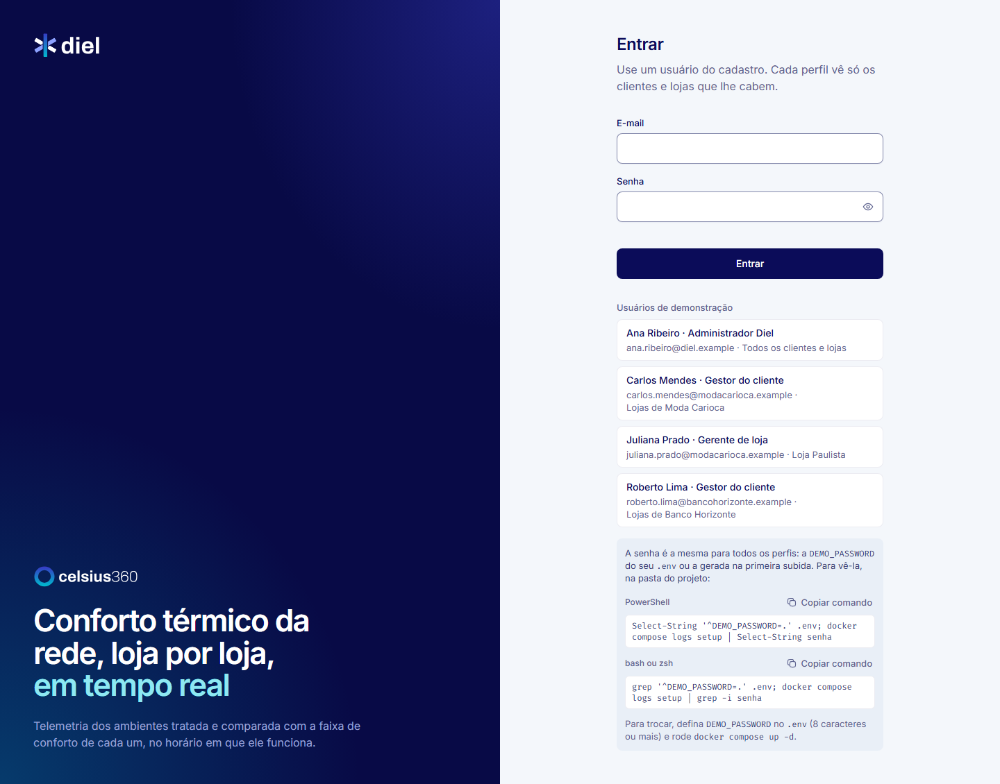
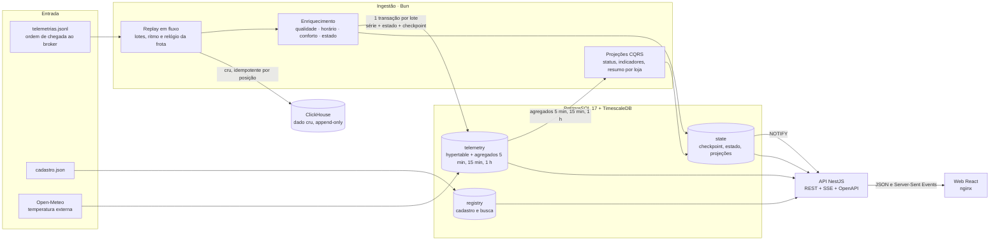
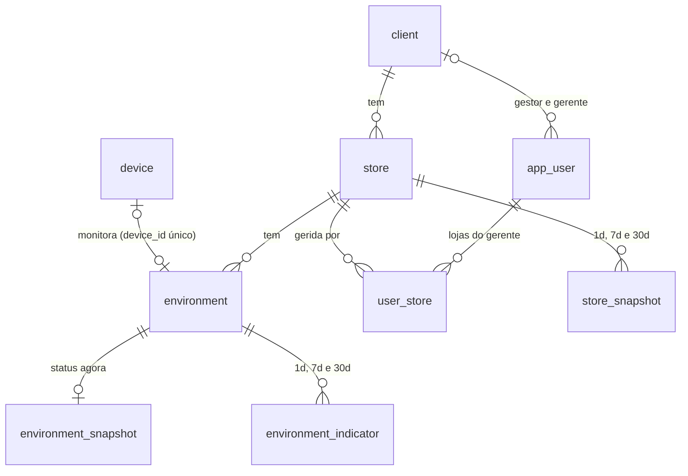

# Celsius 360 Lite

[](https://github.com/esdrasrenan/celsius-360-lite/actions/workflows/ci.yml)

Versão reduzida do Celsius 360, feita para o desafio técnico de Pessoa Desenvolvedora Fullstack Sênior da Diel Energia. O sistema:

- reproduz a telemetria crua dos dispositivos na ordem em que chegou ao broker;
- guarda o dado cru;
- trata e enriquece as séries com as regras do negócio;
- mostra a situação da rede numa aplicação web que se atualiza em tempo real.


<details>
<summary>Telas: detalhe do ambiente e entrada</summary>

Detalhe da Vitrine da Loja Boa Viagem em 30 dias, com uma lacuna sem dados e um trecho de sensor travado:


Entrada:



As capturas saem de `bun run apps/web/e2e/screenshots.ts`, com a stack no ar.

</details>

## Sumário

- [Avaliação rápida](#avaliação-rápida)
- [Roteiro de avaliação](#roteiro-de-avaliação)
- [Problemas comuns](#problemas-comuns)
- [Arquitetura](#arquitetura)
- [Decisões e trade-offs](#decisões-e-trade-offs)
- [Tratamento dos dados](#tratamento-dos-dados)
- [Regras de status e de conforto](#regras-de-status-e-de-conforto)
- [API](#api)
- [Aplicação web](#aplicação-web)
- [Confiabilidade e operação](#confiabilidade-e-operação)
- [Como escalaria](#como-escalaria)
- [Limitações e próximos passos](#limitações-e-próximos-passos)
- [Desenvolvimento](#desenvolvimento)

## Avaliação rápida

**Requisitos:**
- Docker Desktop 4.x (Windows ou macOS) ou Docker Engine com Compose v2 (Linux);
- 4 GB de memória livres para o Docker;
- cerca de 4 GB de disco e 1 GB de download na primeira subida.

Nada mais precisa estar instalado: nem Bun, nem Node, nem banco.

**1. Clone o repositório**

```bash
git clone https://github.com/esdrasrenan/celsius-360-lite.git
cd celsius-360-lite
```

**2. Copie os dados do desafio para a pasta `dados/`**

Os dois arquivos (`cadastro.json` e `telemetrias.jsonl`) são material do processo seletivo e não vão para o repositório.

```powershell
# Windows PowerShell
Copy-Item C:\caminho\dos\dados\cadastro.json, C:\caminho\dos\dados\telemetrias.jsonl dados\
```

```bash
# macOS, Linux ou Git Bash
cp /caminho/dos/dados/cadastro.json /caminho/dos/dados/telemetrias.jsonl dados/
```

Também dá para não copiar: defina `DATA_PATH` no `.env` apontando para a pasta dos dados. Veja o [`.env.example`](.env.example).

**3. Suba tudo com um comando**

```powershell
# Windows (PowerShell 5.1, PowerShell 7 ou cmd)
powershell -ExecutionPolicy Bypass -File scripts\subir.ps1
```

```bash
# macOS, Linux ou Git Bash
sh scripts/subir.sh
```

O script segue estes passos:
1. Confere o Docker, os dados e as portas, e aponta a solução de cada problema.
2. Cria o `.env` com uma senha aleatória, se ainda não houver um.
3. Roda `docker compose up -d --build`.
4. Mostra o progresso da ingestão.
5. Termina com um quadro que traz o endereço, os usuários e de onde vem a senha.

Para só conferir o ambiente sem subir nada, acrescente `-SoVerificar` (PowerShell) ou `--so-verificar` (sh). Quem preferir pode rodar `docker compose up -d --build` direto: os scripts apenas o envolvem.

**4. O que esperar**

- **Primeira subida:** cerca de 1 GB de download e de 3 a 6 minutos do comando ao quadro final, ingestão incluída.
- **Ingestão:** a aplicação já funciona enquanto os 180.951 pacotes são reproduzidos, a 1.000 por segundo (cerca de 3 minutos). A tela se atualiza sozinha nesse tempo.

| O quê                     | Onde                                                            |
| ------------------------- | --------------------------------------------------------------- |
| Aplicação                 | http://127.0.0.1:8080                                           |
| API documentada (Swagger) | http://127.0.0.1:8080/api/docs                                  |
| Saúde e métricas da API   | http://127.0.0.1:3000/health/ready, `/health/live` e `/metrics` |
| Métricas da ingestão      | http://127.0.0.1:9464/metrics, enquanto a ingestão roda         |

**5. Entre**

Os usuários são os do cadastro e aparecem na própria tela de entrada. Nenhuma senha fica no repositório. Os quatro usam a mesma senha, que é:
- a `DEMO_PASSWORD` do `.env`: o script cria uma aleatória e diz onde olhar;
- ou, se você subiu só com `docker compose up` e sem `.env`, a senha gerada na primeira subida, que aparece no log:

```powershell
docker compose logs setup | Select-String Senha     # PowerShell
```

```bash
docker compose logs setup | grep Senha              # bash ou zsh
```

| Usuário                             | Perfil                | Vê                                                        |
| ----------------------------------- | --------------------- | --------------------------------------------------------- |
| ana.ribeiro@diel.example            | administrador da Diel | todos os clientes e lojas, e a página Qualidade dos dados |
| carlos.mendes@modacarioca.example   | gestor do cliente     | as 3 lojas da Moda Carioca                                |
| juliana.prado@modacarioca.example   | gerente de loja       | só a Loja Paulista                                        |
| roberto.lima@bancohorizonte.example | gestor do cliente     | as 2 agências do Banco Horizonte                          |

Para desligar, use `docker compose down`. Com `docker compose down -v`, os dados também são apagados.

## Roteiro de avaliação

Cada requisito do desafio e onde vê-lo funcionando. Os comandos valem para PowerShell e bash. Os links usam as portas padrão; se você mudou `WEB_PORT` no `.env`, troque a porta no endereço.

| Requisito                                                                                        | Onde ver                                                                                                                                                                                                                                                                                                |
| ------------------------------------------------------------------------------------------------ | ------------------------------------------------------------------------------------------------------------------------------------------------------------------------------------------------------------------------------------------------------------------------------------------------------- |
| Ingestão em fluxo, na ordem de chegada                                                           | `docker compose logs -f ingest` durante a subida. O "agora" do cabeçalho avança junto.                                                                                                                                                                                                                  |
| Dado cru armazenado                                                                              | `docker compose exec clickhouse clickhouse-client --query "SELECT source, count() FROM raw.telemetry_packet GROUP BY source"` → 180.951 pacotes                                                                                                                                                         |
| Série tratada                                                                                    | `docker compose exec timescaledb psql -U celsius -d celsius -c "select quality, count(*) from telemetry.reading group by rollup(quality) order by 1"` → por código: 0 válida, 1 erro do sensor, 4 sensor travado; a última linha, sem código, é o total de 2.152.464 amostras                           |
| Visão da rede: status, conforto do período, fora da faixa, busca, filtros, ordenação e paginação | [`/?periodo=30d&ordem=comfort`](http://127.0.0.1:8080/?periodo=30d&ordem=comfort). Busque "provadores", "IOT014" ou "Recife/PE". Os filtros ficam na URL.                                                                                                                                               |
| Centenas de lojas                                                                                | `docker compose run --rm ingest bun run apps/ingest/src/main.ts rede-sintetica --lojas 500`, depois recarregue a visão da rede (26 páginas; busque "campinas"). `--medir` mostra p50 e p95 da listagem e `--limpar` remove só o que é sintético.                                                        |
| Detalhe: gráfico com a faixa, seletor de período, indicadores, lacunas                           | [Vitrine da Loja Boa Viagem em 30 dias](http://127.0.0.1:8080/ambientes/AMB-014?periodo=30d): lacuna de 5 h 45 min sem dados e sensor travado por 10 h 52 min. [Provadores da Loja Tijuca em 7 dias](http://127.0.0.1:8080/ambientes/AMB-003?periodo=7d): 0% do horário na faixa, com 64 h abaixo dela. |
| Temperatura externa (Open-Meteo)                                                                 | A linha tracejada "Externa" no gráfico do detalhe                                                                                                                                                                                                                                                       |
| Tempo real                                                                                       | Com a aplicação aberta: `docker compose run --rm ingest bun run apps/ingest/src/main.ts replay --rebuild`. O chip do cabeçalho vira "Ao vivo", e as telas se esvaziam e voltam a encher sozinhas. A reprodução leva cerca de 3 minutos, no ritmo da demonstração.                                       |
| Autenticação e multi-tenant                                                                      | Saia e entre como `juliana.prado@modacarioca.example`: ela vê só a Loja Paulista. Um ambiente de outra loja responde 404, como se não existisse.                                                                                                                                                        |
| Reprocessamento seguro                                                                           | `docker compose run --rm ingest bun run apps/ingest/src/main.ts replay --from-start --rate 0` (cerca de 40 s; sem `--rate 0`, segue o ritmo da demonstração e leva 3 minutos) e repita as duas contagens acima: nada duplica.                                                                           |
| Qualidade dos dados                                                                              | A página [Qualidade dos dados](http://127.0.0.1:8080/qualidade), como administrador, e [docs/qualidade-dos-dados.md](docs/qualidade-dos-dados.md)                                                                                                                                                       |
| Identidade visual da Diel                                                                        | [docs/DESIGN.md](docs/DESIGN.md): tokens, tipografia, contraste verificado e componentes                                                                                                                                                                                                                |
| Testes e CI                                                                                      | O selo do CI no topo e a seção [Confiabilidade e operação](#confiabilidade-e-operação)                                                                                                                                                                                                                  |

## Problemas comuns

| Sintoma                                                                                | Causa provável                                                                 | Solução                                                                                                                                                                                                                                                                                                          |
| -------------------------------------------------------------------------------------- | ------------------------------------------------------------------------------ | ---------------------------------------------------------------------------------------------------------------------------------------------------------------------------------------------------------------------------------------------------------------------------------------------------------------- |
| O script diz que uma porta está ocupada                                                | Outro programa usa a 8080, a 3000, a 55432, a 58123 ou a 9464                  | Troque a porta no `.env`, que o script já criou, e rode de novo: `Add-Content .env WEB_PORT=8081 -Encoding ascii` (PowerShell) ou `echo WEB_PORT=8081 >> .env` (bash). Se a porta é de outra cópia deste projeto, defina também `COMPOSE_PROJECT_NAME` no `.env`: sem isso, as duas cópias mexem na mesma stack. |
| "cadastro.json não encontrado" ou o setup falha                                        | Os dados não estão em `dados/`, ou foram copiados com a pasta (`dados/dados/`) | Deixe os dois arquivos direto em `dados/`, ou aponte `DATA_PATH` no `.env`. O script detecta os dois casos e mostra o comando.                                                                                                                                                                                   |
| Esqueci ou perdi a senha                                                               | A senha gerada aparece só na primeira subida                                   | Defina `DEMO_PASSWORD=uma-senha-sua` (mínimo de 8 caracteres) no `.env` e rode `docker compose up -d`. A senha dos quatro usuários é redefinida.                                                                                                                                                                 |
| "Muitas tentativas" ao entrar                                                          | Bloqueio depois de 5 falhas por e-mail em 5 minutos                            | Espere 5 minutos, ou rode `docker compose restart api`.                                                                                                                                                                                                                                                          |
| `docker compose` diz `failed to read .env: unexpected character`                       | O arquivo foi criado com `>` no Windows PowerShell 5.1, que grava em UTF-16    | Converta com `(Get-Content .env) \| Set-Content .env -Encoding ascii`, que mantém o conteúdo. O script avisa quando encontra esse caso.                                                                                                                                                                          |
| A subida para em `service "setup" didn't complete successfully` e a aplicação não abre | `JWT_SECRET` com menos de 32 caracteres, ou `DEMO_PASSWORD` com menos de 8     | `docker compose logs setup` mostra "Configuração inválida" e o campo. Apague a linha (o setup gera um segredo persistente) ou use um valor maior. O script de subida avisa antes.                                                                                                                                |
| Os contêineres morrem durante a ingestão                                               | Pouca memória para o Docker                                                    | Libere 4 GB para o Docker (Docker Desktop → Settings → Resources).                                                                                                                                                                                                                                               |
| A temperatura externa não aparece                                                      | Sem internet na hora do setup                                                  | O setup usa o cache versionado em `db/seed/`. Nada a fazer.                                                                                                                                                                                                                                                      |
| Depois de reiniciar o computador, a aplicação não abre                                 | O Docker ainda não subiu                                                       | Abra o Docker Desktop. Os serviços voltam sozinhos (`restart: unless-stopped`). Se precisar, rode `docker compose up -d`.                                                                                                                                                                                        |
| Linux com SELinux: "permission denied" ao ler `dados/`                                 | A pasta não tem o rótulo que o contêiner pode ler                              | `chcon -Rt container_file_t dados` e rode de novo.                                                                                                                                                                                                                                                               |

## Arquitetura



O código fica num monorepo com workspaces do Bun:

| Pasta                | Papel                                                                                                                                                                                                                 |
| -------------------- | --------------------------------------------------------------------------------------------------------------------------------------------------------------------------------------------------------------------- |
| `packages/domain`    | Regras do negócio em TypeScript puro, sem framework: pacote, qualidade das leituras, horário de funcionamento por fuso, conforto, status, períodos, lacunas e o relógio da frota. É o que os testes unitários cobrem. |
| `packages/contracts` | Tipos das respostas da API. A API implementa e a web consome; se um lado muda sem o outro, o build quebra.                                                                                                            |
| `apps/ingest`        | CLI de ingestão: migrações, cadastro, temperatura externa, reprodução da telemetria, projeções, relatório de qualidade e a rede sintética.                                                                            |
| `apps/api`           | API NestJS: sessão e escopo, visão da rede, detalhe do ambiente, eventos em tempo real, qualidade, saúde e métricas.                                                                                                  |
| `apps/web`           | Aplicação React com a identidade da Diel, servida pelo nginx, que também faz o proxy de `/api`.                                                                                                                       |
| `db/`                | Migrações SQL do Postgres/TimescaleDB e do ClickHouse; cache da temperatura externa.                                                                                                                                  |
| `scripts/`           | Subida do avaliador (`subir.ps1`, `subir.sh`), stack de E2E, gerador do fixture e a checagem do sistema visual.                                                                                                       |

## Decisões e trade-offs

### Bancos e modelagem

Os três tipos de dado têm naturezas diferentes, e cada um foi para onde faz sentido.

**Dado cru no ClickHouse.**
- **Perfil de carga:** em produção são 20 GB por dia, escritos só por inserção, imutáveis e lidos raramente, por varredura (auditoria, reprocessamento, análise). Um banco colunar com compressão ZSTD guarda isso com custo baixo por GB e varre bilhões de linhas em segundos.
- **O que a tabela guarda:** cada pacote exatamente como chegou (`payload`), mais as colunas já interpretadas.
- **Chave:** a posição na fonte (`source`, `seq`). Ela é a ordem de chegada e a identidade do pacote, e permite reprocessar sem duplicar.
- **Partição:** mensal, pelo horário do pacote, pensando em retenção (TTL) e em mover partições antigas para armazenamento frio.
- **Na GCP**, o equivalente gerenciado seria GCS + BigQuery particionado por dia e clusterizado por dispositivo.

**Série tratada no TimescaleDB.**
- **Linha:** uma por amostra (dispositivo, instante), já classificada, numa hypertable com partição diária.
- **Agregados contínuos** de 5 min, 15 min e 1 h, hierárquicos: servem os gráficos e os indicadores. A invalidação do Timescale marca os buckets que recebem dado atrasado, e a ingestão recalcula só esse trecho.
- **Índice parcial** sobre as leituras válidas no horário de funcionamento: dá a temperatura média "no horário" exata, sem materializar outro agregado.

**Cadastro no PostgreSQL**, no schema `registry`. O volume é pequeno, as relações são fortes e há integridade referencial e transações. Lojas e ambientes têm uma coluna de busca gerada (sem acento, com índice trigrama) que cobre nome, cidade, UF, cliente, ambientes e dispositivos.



- **Cadastro (`registry`):** `client`, `store`, `environment`, `device`, `app_user` e `user_store`. O ambiente tem a faixa de conforto e o horário próprios, e um dispositivo serve a um ambiente só.
- **Perfil vira escopo a cada requisição:** `admin_diel` vê tudo, `gestor_cliente` vê as lojas do seu `client_id` e `gerente_loja` vê as de `user_store`. Um `CHECK` garante que só o administrador fica sem cliente.
- **Projeções (`state`):** uma linha por ambiente com o status agora, e uma por ambiente ou loja e período (`1d`, `7d`, `30d`) com os indicadores. A chave (`environment_id, period`) ou (`store_id, period`) é o que a visão da rede filtra e ordena.
- **Série (`telemetry.reading`):** chave dispositivo + instante, sem chave estrangeira para o cadastro. Quem barra o dispositivo desconhecido é a ingestão, que o põe em quarentena (`state.unknown_device`).

**Trade-off assumido:** cadastro, série e estado ficam na mesma instância Postgres, em schemas separados.
- **Ganho:** a visão da rede junta cadastro e indicadores numa consulta com filtro, ordenação e paginação. A gravação da série, do estado e do checkpoint cabe numa única transação, que é a base do reprocessamento seguro.
- **Em escala maior:** a série vai para um cluster próprio, e a API lê uma projeção replicada.

### Organização dos serviços

- **Ingestão:**
  - **Leitura em fluxo:** um processo lê a fonte sem carregar o arquivo inteiro, agrupa em lotes e grava em dois destinos.
  - **Entrega:** "pelo menos uma vez", com destinos idempotentes. O cru pula o que já existe pela marca d'água de `seq`. A série ignora amostra repetida (chave dispositivo + instante). Estado e checkpoint só avançam (`GREATEST`). Série, estado e checkpoint vão numa transação por lote.
  - **Falhas:** se o banco cai, a ingestão tenta de novo e retoma do checkpoint. No SIGTERM, grava o lote em curso e para.
- **Lado de leitura separado (CQRS).** A cada ciclo, a ingestão aplica as regras do domínio e recalcula:
  - o status e a situação de cada ambiente;
  - os indicadores dos três períodos;
  - o resumo de cada loja, com o pior ambiente e a próxima abertura.

  A API só lê essas projeções (`state.*`) na visão da rede. Página, totais e contagens de filtro saem de um mesmo instantâneo (REPEATABLE READ). Com 505 lojas, a listagem responde em 12 ms no p50 e 14 ms no p95, e a troca de página fica abaixo de 16 ms.
- **API sem estado de negócio, escalável horizontalmente.**
  - **Tempo real:** usa `LISTEN/NOTIFY` do Postgres. A ingestão notifica ao atualizar as projeções, e a API repassa por Server-Sent Events. O primeiro evento traz o estado atual da ingestão.
  - **O que ainda vive na memória do processo:** o bloqueio de login e o cache de escopo, ambos por instância. A sessão sobrevive a reinícios porque o segredo fica num volume.
- **"Agora"** é sempre o horário do último pacote processado, nunca o relógio do servidor. Os períodos e os status partem dele, e a reprodução é determinística: rodar duas vezes gera exatamente o mesmo estado.
  - **Proteção contra relógio adiantado:** um único dispositivo com o relógio adiantado não consegue empurrar o "agora". Um salto de mais de 10 min só vale quando outros dispositivos cadastrados confirmam um horário próximo (2 ou 20% dos que enviaram na última hora, o que for maior); sem isso, o pacote vai para o cru marcado e fica de fora.
  - **Dispositivo fora do cadastro:** nunca mexe no relógio.

### API

- **Paginação por `OFFSET`, com total e contagens por filtro do mesmo instantâneo.** A paginação por cursor (keyset) sai mais barata em páginas profundas, mas não dá o total nem os números de página, que valem mais numa lista de centenas de lojas ordenada por gravidade. O custo cresce com a profundidade da página, e o tamanho da página vai no máximo a 100.
- **Agregação escolhida pelo tamanho do intervalo.** Em 30 dias, a série vem em pontos de 1 h (720 por ambiente), e nenhuma resposta passa de 5.000 pontos. A alternativa seria mandar as amostras de 30 s (86.400 em 30 dias) e reduzir no navegador. O custo é que a variação dentro de cada ponto aparece só como faixa mín–máx.
- **Tempo real como aviso, não como dado.** O evento `state_updated` traz só o "agora" e a posição da ingestão, e a web refaz as consultas que estão na tela. Mandar o dado no evento exigiria aplicar escopo, filtros e página de cada usuário no canal de eventos. O custo é uma rodada de consultas por aviso, agrupadas pela web a cada 1,5 s.
- **Server-Sent Events em vez de WebSocket.** O fluxo é só do servidor para o navegador e passa pelo proxy HTTP do nginx sem upgrade de protocolo, só com o buffer desligado. WebSocket traria um protocolo próprio e um canal de ida e volta que nada aqui usa.
- **Sessão em cookie httpOnly com JWT, em vez de token guardado pelo front.** O JavaScript da página não lê a sessão, e o `EventSource`, que não manda cabeçalho de autorização, autentica pelo mesmo cookie. O custo é a falta de revogação antes das 8 h (veja Limitações).

### Aplicação web

- **Estado na URL:** período, busca, filtros, ordem e página. O link é compartilhável, o voltar do navegador funciona e recarregar não perde a tela. O custo é validar cada parâmetro que chega pela URL.
- **Paginação no servidor em vez de virtualização.** Virtualizar exigiria baixar a lista inteira, o que não escala para milhares de lojas, e filtro e ordenação já acontecem no banco. Para ter tudo de uma vez, há a exportação em CSV da lista filtrada.
- **Consultas do TanStack Query refeitas a cada aviso, com o dado atual na tela até o novo chegar.** A tela não pisca nem perde zoom e filtros durante a ingestão. O custo é mostrar por um instante um dado de alguns segundos atrás.

### Por que estas ferramentas

- **TypeScript de ponta a ponta com Bun:** um runtime para ingestão, API, testes e build, com tipos compartilhados entre back e front.
- **NestJS na API:** módulos, injeção de dependência, guards e validação declarativa, com o OpenAPI gerado dos DTOs e erros em `application/problem+json`.
- **Regras fora do framework:** o domínio não conhece Nest, banco nem HTTP, e ingestão e API usam as mesmas funções.
- **Base UI e ECharts na web:** o Base UI dá select, combobox, dicas e menus acessíveis sem impor visual. O ECharts dá um gráfico de série temporal com camadas, zoom e boa performance no canvas.

## Tratamento dos dados

A análise completa, com números e como reproduzi-la, está em [docs/qualidade-dos-dados.md](docs/qualidade-dos-dados.md). Em resumo:

| Encontrado nos dados                                                                                   | Tratamento                                                                                                                                   |
| ------------------------------------------------------------------------------------------------------ | -------------------------------------------------------------------------------------------------------------------------------------------- |
| 1.099 pacotes duplicados exatos                                                                        | O cru guarda cada chegada; a série grava uma amostra por dispositivo e instante.                                                             |
| 247 pacotes `saved_data`, 239 chegando de 15 min a 5,7 h atrasados                                     | Entram na série no lugar certo, e os agregados daquele trecho são recalculados.                                                              |
| 285 leituras -127 (sensor desconectado), 9 pacotes inteiros, sem contar um pacote que chegou duplicado | Descartadas como erro do sensor. Na série, com as 47 leituras 85, são 332 amostras.                                                          |
| 47 leituras 85 (valor de power-on), a primeira amostra depois de cada reinício                         | Descartadas como erro do sensor.                                                                                                             |
| 2 sensores travados no mesmo valor por cerca de 11 h (IOT009 e IOT014)                                 | Valor idêntico por 60 min ou mais é marcado como travado, inclusive o começo da sequência. O dispositivo vira "falha no sensor" na detecção. |
| IOT099, 481 pacotes, fora do cadastro                                                                  | Fica no cru, em quarentena, fora da série e do relógio, e aparece no relatório.                                                              |
| 6 lacunas sem dado (de 2 h 15 min a 5 h 45 min) e cerca de 370 pacotes perdidos                        | Visíveis no gráfico e listadas como indisponibilidade. Não contam como dentro nem fora da faixa.                                             |

Nada é apagado: a leitura descartada continua na série com o motivo (`quality`). O relatório de qualidade é recalculado a cada ingestão e aparece na página **Qualidade dos dados**, que só o administrador vê.

## Regras de status e de conforto

Os pacotes chegam a cada 6 minutos, com 12 amostras de 30 s.

| Status do dispositivo (e do ambiente) | Regra                                                                                                               |
| ------------------------------------- | ------------------------------------------------------------------------------------------------------------------- |
| Online                                | comunicou nos últimos 15 min e tem leitura válida nesse intervalo                                                   |
| Falha no sensor                       | comunica, mas está sem leitura válida há mais de 15 min (erro do sensor) ou com o sensor travado (desde a detecção) |
| Offline                               | sem comunicação há mais de 15 min (dois pacotes perdidos e uma margem)                                              |
| Sem dados                             | nunca comunicou                                                                                                     |

A loja fica:
- **online** com todos os ambientes online;
- **parcial** com algum ambiente fora disso;
- **offline** sem nenhum comunicando;
- **sem dados** se nenhum jamais comunicou.

**Conforto.**
- **Avaliação:** cada amostra válida é comparada com a faixa do ambiente (limites inclusivos), só dentro do horário de funcionamento, no fuso da loja (IANA, com horário de verão).
- **Indicador do período:** é o percentual do tempo de funcionamento **com leitura válida** que ficou dentro da faixa, separado em acima e abaixo.
- **Lacunas:** não contam como dentro nem fora. Aparecem à parte, na **cobertura**, que é o percentual do horário de funcionamento com leitura válida.
- **Loja e rede:** ponderam os ambientes pelo tempo com leitura.
- **Situação agora:** dentro, acima ou abaixo da faixa, ou fechado (com a próxima abertura).
- **Meta:** 90% do horário na faixa; abaixo de 70% é crítico.

O que os dados mostram:
- A rede passa 93,2% do horário na faixa em 30 dias. O problema dominante é frio (5,0% abaixo), não calor (1,7% acima).
- Os Provadores da Loja Tijuca ficam só 0,2% do horário na faixa em 30 dias (0% na última semana): o ar derruba a temperatura para cerca de 19,5 °C no expediente, com faixa de 22 a 25 °C. É ajuste de setpoint, não falta de ar.
- A Vitrine de Recife esquenta na abertura: o perfil semanal mostra de 54% a 81% do tempo acima da faixa às 10 h nos dias úteis.

## API

REST versionada em `/api/v1`, documentada em OpenAPI (Swagger em `/api/docs`, JSON em `apps/api/openapi.json`, conferido no CI). Os erros seguem `application/problem+json` (RFC 9457), com mensagem em português, os campos inválidos e o id da requisição.

| Rota                                                    | O quê                                                                                                                                                                                                                                                                                                                                                                                                |
| ------------------------------------------------------- | ---------------------------------------------------------------------------------------------------------------------------------------------------------------------------------------------------------------------------------------------------------------------------------------------------------------------------------------------------------------------------------------------------- |
| `POST /auth/login`, `POST /auth/logout`, `GET /auth/me` | Sessão em cookie httpOnly (JWT, 8 h) e senha com argon2id. Bloqueio por IP (20 tentativas por minuto) e por e-mail (5 falhas em 5 min).                                                                                                                                                                                                                                                              |
| `GET /auth/demo-users`                                  | Pública: nome, e-mail, perfil e alcance dos usuários (sem senha), para a tela de entrada. Só existe com `DEMO_MODE=true`, o padrão no Compose; com `false`, responde 404.                                                                                                                                                                                                                            |
| `GET /stores`                                           | Lojas com status, indicadores do período, pior ambiente e ambientes. **Filtros:** `period`, `search` (até 5 termos, sem acento, inclusive ambiente e dispositivo), `clientId`, `storeId`, `status`, `belowTarget`, `outOfRange`. **Ordenação:** gravidade, pior ou melhor conforto, pior ambiente, fora da faixa e nome, sempre estável. Totais da rede e contagens por filtro do mesmo instantâneo. |
| `GET /clients`                                          | Clientes visíveis, para o filtro.                                                                                                                                                                                                                                                                                                                                                                    |
| `GET /environments/{id}/summary`                        | Cadastro, status agora e indicadores do período (`period` ou `from`/`to`), com a temperatura e as lacunas no horário.                                                                                                                                                                                                                                                                                |
| `GET /environments/{id}/series`                         | Série com agregação escolhida pelo tamanho do intervalo (30 s até 8 h; 5 min até 3,5 dias; 15 min até 10 dias; 1 h acima), lacunas com motivo, temperatura externa e horário de funcionamento.                                                                                                                                                                                                       |
| `GET /environments/{id}/profile`                        | Perfil semanal: hora × dia da semana no fuso da loja.                                                                                                                                                                                                                                                                                                                                                |
| `GET /environments/{id}/daily`                          | Conforto por dia, no fuso da loja.                                                                                                                                                                                                                                                                                                                                                                   |
| `GET /events`                                           | Server-Sent Events: o estado atual da ingestão ao conectar e um aviso a cada atualização.                                                                                                                                                                                                                                                                                                            |
| `GET /quality`                                          | Relatório de qualidade dos dados (só administrador).                                                                                                                                                                                                                                                                                                                                                 |
| `GET /health/live`, `GET /health/ready`, `GET /metrics` | Operação, na porta 3000. Não passam pelo nginx da aplicação.                                                                                                                                                                                                                                                                                                                                         |

**Multi-tenant.** O escopo do usuário (todas as lojas, as do cliente ou as listadas) é resolvido a cada requisição e aplicado em todas as consultas. Um ambiente fora do escopo responde 404, como se não existisse.

**Entradas validadas.**
- Datas: só ISO 8601 com fuso, que existem de verdade, com janela de no máximo 92 dias.
- Série: no máximo 5.000 pontos.
- Ordenação: lista fechada, nunca texto livre no SQL.
- Busca: o termo é escapado.

## Aplicação web

React 19 com Vite, React Router, TanStack Query, Base UI e ECharts, compilada com o React Compiler. O sistema visual (tokens, tipografia, contraste, componentes) está descrito em [docs/DESIGN.md](docs/DESIGN.md).

**Visão da rede.** Feita para centenas de lojas:
- tabela com cabeçalho fixo e lojas com problema primeiro e abertas;
- paginação, ordenação e filtros no servidor, e todo o estado na URL;
- quatro indicadores: conforto da rede com a distribuição acima e abaixo, fora da meta com o pior ambiente, fora da faixa entre os ambientes abertos, e telemetria;
- busca por loja, ambiente, cidade, cliente ou dispositivo, com o termo destacado;
- pílulas de status com contagem;
- exportação em CSV da lista filtrada inteira.

**Detalhe do ambiente.**
- **Gráfico em camadas,** cada uma liga e desliga na legenda:
  - faixa de conforto só no expediente;
  - loja fechada;
  - lacunas sem dados e leituras descartadas, cada uma com sua hachura;
  - variação mín–máx;
  - temperatura externa;
  - período anterior.
- **Leitura do gráfico:**
  - abaixo do plot, uma tira mostra a situação ao longo do tempo;
  - o tooltip explica cada ponto;
  - o zoom é feito com Ctrl + rolagem ou com o controle abaixo do gráfico.
- **Indicadores do período:** conforto, temperatura e indisponibilidade no horário, e cobertura de dados. Dá para comparar com o período anterior.
- **Análises:** perfil semanal (hora × dia) e conforto por dia.
- **Lacunas:** lista com "Ver no gráfico".
- **Exportação:** tabela de dados, CSV da série e das lacunas, e "Imprimir ou salvar PDF".

**Tempo real.**
- **Chip do cabeçalho:** "Ao vivo" enquanto a ingestão roda, "Dados até 10/02 23:59" quando a reprodução termina e "Reconectando" quando a conexão cai.
- **Telas:** se atualizam sem perder zoom nem filtros.

**Responsiva e acessível.**
- Funciona de 320 px a desktop sem rolagem horizontal; no celular, os filtros vão para uma gaveta.
- Navegação por teclado no gráfico, resumo em texto para leitor de tela e contraste verificado por teste.

## Confiabilidade e operação

- **Testes:**
  - unitários: domínio, formatação, componentes e camadas do gráfico;
  - integração contra TimescaleDB e ClickHouse reais: pipeline, idempotência, retomada no meio de uma sequência, queda do banco, relógio da frota, busca, escopo, SSE, robustez da API e OpenAPI;
  - E2E com Playwright contra a stack completa do Compose, inclusive em 320, 390, 768, 820 e 1440 px.
- **CI no GitHub Actions:**
  - lint (Biome), tipos (TypeScript 7) e a checagem do sistema visual;
  - unitários e integração, com os bancos como serviços;
  - E2E subindo o Compose;
  - drift do OpenAPI;
  - um job no Windows que roda o `subir.ps1 -SoVerificar` no PowerShell 5.1 e confere que, com uma porta ocupada, o script para e deixa o `.env` pronto, com a senha;
  - a subida do zero pelo `subir.sh`.
- **Observabilidade:**
  - logs JSON (pino) com o id da requisição propagado pelo cabeçalho `x-request-id`, aceito só com até 64 letras, dígitos, `.`, `_` ou `-` (fora disso, a API gera outro);
  - métricas Prometheus na API (latência por rota) e na ingestão (pacotes por resultado, amostras por qualidade, duração do lote, "agora");
  - `health/live` e `health/ready`;
  - o relatório de qualidade dos dados.
- **Resiliência:**
  - o pool trata a queda do banco, e consulta lenta tem limite (`statement_timeout`);
  - uma requisição ruim nunca derruba o processo;
  - a ingestão retoma do checkpoint;
  - os serviços voltam sozinhos depois de reiniciar o Docker.
- **Reprodutibilidade:**
  - um comando sobe tudo;
  - migrações versionadas com checksum;
  - reprodução determinística;
  - cache da temperatura externa para rodar sem internet.
- **Segurança:**
  - nenhum segredo versionado; o segredo da sessão é gerado no primeiro setup e guardado num volume;
  - portas presas a 127.0.0.1;
  - cookie httpOnly e SameSite;
  - imagem sem root;
  - validação de toda entrada;
  - `X-Forwarded-For` sobrescrito pelo nginx, para que o bloqueio de login não seja contornado;
  - a lista pública de usuários da tela de entrada (`/auth/demo-users`) é recurso da demonstração: em produção, `DEMO_MODE=false` a desliga.

## Como escalaria

Com os 110 mil dispositivos da Diel, a um pacote a cada 6 minutos, são cerca de 300 pacotes por segundo; 20 GB por dia são cerca de 230 KB/s. Esta ingestão, num processo só, grava cerca de 3.400 pacotes por segundo no cru e na série: 180.951 pacotes em 53 s, num desktop com Intel i7-14700F e Docker Desktop no Windows. Para medir na sua máquina, rode `docker compose run --rm ingest bun run apps/ingest/src/main.ts replay --rebuild --rate 0` e divida `packets` por `seconds` no log "ingestão concluída" (o `--rebuild` refaz a série e pula o cru já gravado; aqui levou 53,7 s). O desenho para produção:

1. **Borda:** os dispositivos publicam em MQTT (EMQX ou HiveMQ). Uma ponte joga no Kafka ou no Pub/Sub, particionado por dispositivo para manter a ordem. O "agora" passa a ser o horário de recebimento no broker.
2. **Processamento:**
   - consumidores sem estado, um grupo para o cru (GCS em Parquet + BigQuery) e outro para a série (Timescale);
   - escala pelo número de partições (HPA no Kubernetes);
   - o checkpoint passa a ser o offset do consumidor.
3. **Série:**
   - compressão depois de 7 dias;
   - retenção do dado de 30 s por 90 dias, e dos agregados por mais tempo;
   - particionamento por cliente, se um cluster não bastar.
4. **Leitura:**
   - a API escala horizontalmente, e as projeções continuam sendo a base da visão da rede;
   - o fan-out de tempo real sai do `LISTEN/NOTIFY` para um broker (Redis Streams ou NATS), com tópico por cliente;
   - o bloqueio de login e o cache de escopo vão para o Redis.
5. **Operação:** OpenTelemetry nos três serviços, com alertas de atraso da ingestão (lag) e de dispositivos offline.

## Limitações e próximos passos

- O vínculo entre dispositivo e ambiente é fixo. Trocar um dispositivo de ambiente pediria um histórico com vigência.
- Horário e conforto são calculados na gravação. Mudar a faixa ou o horário de um ambiente exige `replay --rebuild`, ou um job que recalcule só os trechos afetados.
- A detecção de sensor travado só olha pacotes em ordem; pacotes atrasados não entram nela.
- As lacunas são calculadas na consulta, com resolução de 5 minutos.
- Sessão sem revogação (JWT de 8 h). Em produção, use sessão no servidor ou tokens curtos com renovação.
- Depois de um silêncio da frota inteira por mais de 10 min, os primeiros pacotes que chegam esperam outros dispositivos confirmarem o horário e ficam no cru como `timestamp_futuro`. Em produção, a referência seria o recebimento no broker.
- O dado cru é particionado pelo horário informado pelo dispositivo. Um relógio muito errado ainda cria uma partição isolada no ClickHouse.

## Desenvolvimento

Com Bun 1.4.3. Os comandos funcionam no PowerShell, no cmd e no bash.

```bash
bun install
bun run infra                    # só os bancos, via Compose
bun run setup                    # migrações, cadastro e temperatura externa (lê dados/)
bun run replay                   # ingestão local
bun run dev:api                  # API em http://127.0.0.1:3000
bun run dev:web                  # web em http://127.0.0.1:5173, com proxy para a API
```

O `dev:api` lê o `.env` da raiz e roda em modo de demonstração (`DEMO_MODE=true`): a tela de entrada lista os usuários e, sem `JWT_SECRET` no `.env`, a sessão usa um segredo temporário, que cai a cada reinício. Com a stack do Compose no ar, a porta 3000 já está ocupada; use outra com `PORT` e aponte a web para ela com `API_URL`.

```bash
bun run lint                     # Biome
bun run lint:ui                  # regras do sistema visual (tokens, sem caixa alta por CSS, sem title, sem select nativo)
bun run typecheck
bun run test                     # unitários (domínio e web)
bun run test:integration         # ingestão e API contra TimescaleDB e ClickHouse reais
bun run e2e:install              # uma vez: Chromium do Playwright
bun run e2e:stack                # stack completa com dados sintéticos, em portas próprias
bun run test:e2e                 # Playwright contra essa stack
bun run e2e:down
```

Os testes não dependem dos dados do desafio. O `scripts/gerar-fixture.ts` gera um conjunto sintético e determinístico (em `test/fixtures`), com as mesmas anomalias dos dados reais e o resultado esperado de cada uma.

- **Integração:** cada execução cria um banco descartável e uma fonte própria no ClickHouse, e apaga os dois no fim.
- **E2E:** usa um projeto Compose separado (`celsius-e2e`) e não toca na stack principal.

## Uso de IA

Este projeto foi desenvolvido com assistência do Claude Code. A IA ajudou na análise dos dados, na escrita do código e dos testes e na documentação; as decisões de arquitetura e os critérios de tratamento dos dados foram revisados e validados por mim, e todo o código passou pelos testes e pela execução local antes da entrega.

---

Dados meteorológicos: [Open-Meteo](https://open-meteo.com/), licença CC BY 4.0.
