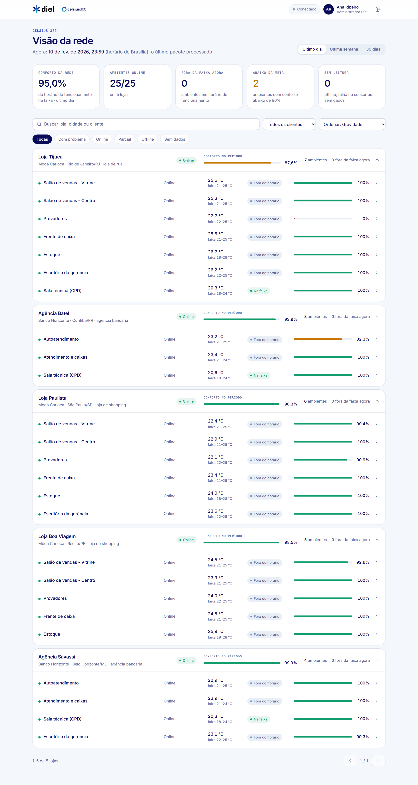
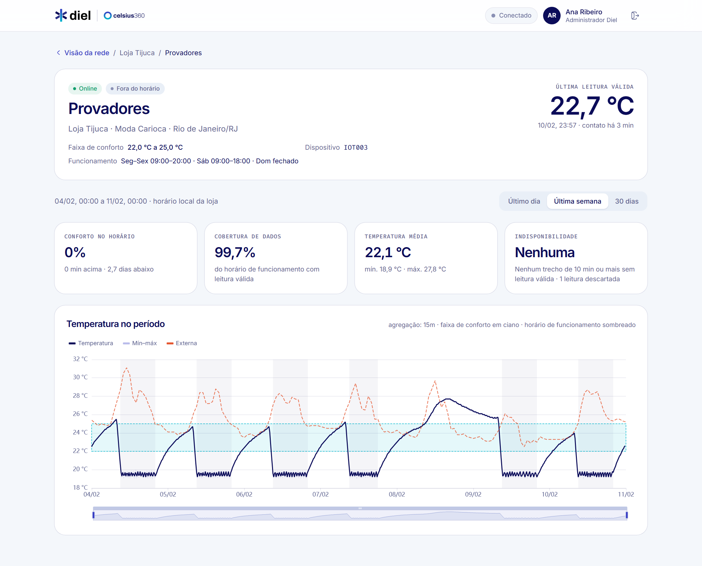
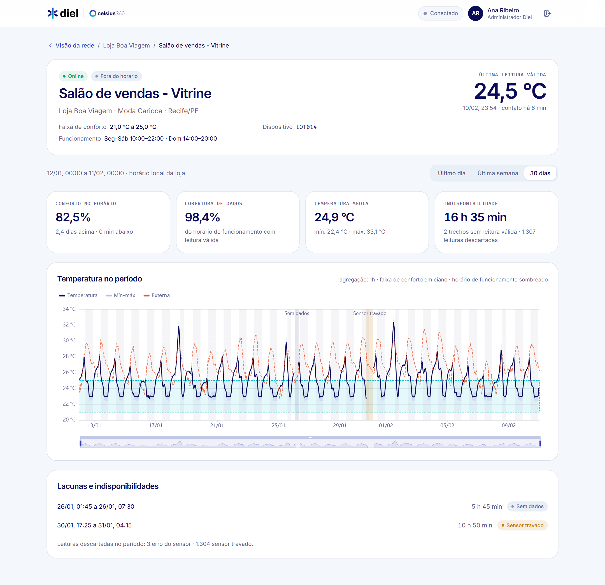
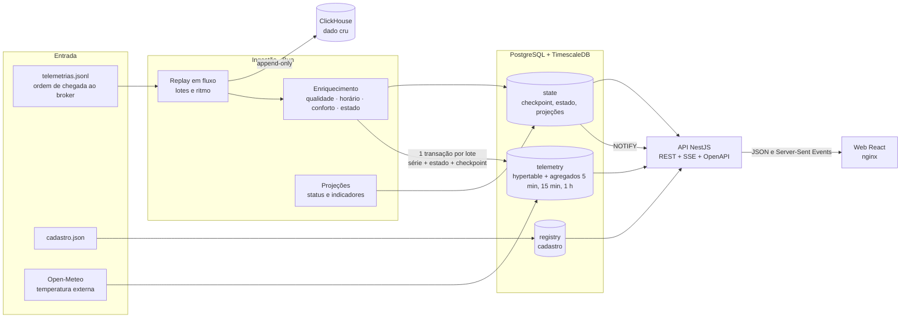

# Celsius 360 Lite

Versão reduzida do Celsius 360, feita para o desafio técnico de Pessoa Desenvolvedora Fullstack Sênior da Diel Energia. O sistema reproduz a telemetria crua dos dispositivos na ordem em que chegou ao broker, guarda o dado cru, trata e enriquece as séries com as regras do negócio e mostra a situação da rede numa aplicação web, com atualização em tempo real.



| Detalhe do ambiente (Provadores, Loja Tijuca, 7 dias)         | Lacuna e sensor travado (Vitrine, Loja Boa Viagem, 30 dias)              |
| ------------------------------------------------------------- | ------------------------------------------------------------------------ |
|  |  |

## Sumário

- [Como rodar do zero](#como-rodar-do-zero)
- [Arquitetura](#arquitetura)
- [Decisões e trade-offs](#decisões-e-trade-offs)
- [Tratamento dos dados](#tratamento-dos-dados)
- [Regras de status e de conforto](#regras-de-status-e-de-conforto)
- [API](#api)
- [Aplicação web](#aplicação-web)
- [Confiabilidade e operação](#confiabilidade-e-operação)
- [Como escalaria](#como-escalaria)
- [Limitações e próximos passos](#limitações-e-próximos-passos)

## Como rodar do zero

Pré-requisito: Docker com Compose. Nada mais precisa estar instalado na máquina.

```bash
git clone <url-do-repositório> celsius-360-lite
cd celsius-360-lite

# Os dados do desafio não são versionados (são material do processo seletivo).
# Copie os dois arquivos recebidos para a pasta dados/:
cp /caminho/dos/dados/cadastro.json /caminho/dos/dados/telemetrias.jsonl dados/

docker compose up -d --build
```

| O quê                         | Onde                                                     |
| ----------------------------- | -------------------------------------------------------- |
| Aplicação web                 | http://localhost:8080                                    |
| Documentação da API (Swagger) | http://localhost:8080/api/docs                           |
| Métricas da API (Prometheus)  | http://localhost:3000/metrics                            |
| Métricas da ingestão          | http://localhost:9464/metrics (enquanto a ingestão roda) |

O que acontece ao subir:

1. `setup` aplica as migrações, valida e grava o cadastro e busca a temperatura externa horária de cada loja no Open-Meteo. Sem internet, usa o cache versionado em `db/seed/`.
2. `ingest` reproduz `telemetrias.jsonl` na ordem do arquivo, a 1.000 pacotes por segundo (os 30 dias passam em cerca de 3 minutos). A tela se atualiza enquanto isso.
3. `api` e `web` sobem assim que o setup termina.

**Login.** Os usuários são os do cadastro, listados na própria tela de entrada. Nenhuma senha fica no repositório: defina `DEMO_PASSWORD` antes de subir, ou use a senha que o setup gera e mostra no log:

```bash
docker compose logs setup | grep -i senha
```

| Usuário                             | Perfil                | Vê                               |
| ----------------------------------- | --------------------- | -------------------------------- |
| ana.ribeiro@diel.example            | administrador da Diel | todos os clientes e lojas        |
| carlos.mendes@modacarioca.example   | gestor do cliente     | as 3 lojas da Moda Carioca       |
| juliana.prado@modacarioca.example   | gerente de loja       | só a Loja Paulista               |
| roberto.lima@bancohorizonte.example | gestor do cliente     | as 2 agências do Banco Horizonte |

**Variáveis úteis** (num `.env` na raiz ou na linha de comando):

| Variável                                                   | Padrão                   | Para quê                                                                                               |
| ---------------------------------------------------------- | ------------------------ | ------------------------------------------------------------------------------------------------------ |
| `INGEST_RATE`                                              | `1000`                   | pacotes por segundo na reprodução; `0` processa o mais rápido possível (cerca de 80 s para os 30 dias) |
| `DEMO_PASSWORD`                                            | gerada                   | senha dos usuários de demonstração                                                                     |
| `JWT_SECRET`                                               | gerado a cada subida     | segredo da sessão; defina para as sessões sobreviverem a reinícios                                     |
| `WEB_PORT`, `API_PORT`, `POSTGRES_PORT`, `CLICKHOUSE_PORT` | 8080, 3000, 55432, 58123 | portas no host, todas ligadas só a 127.0.0.1                                                           |

**Reprocessar.** Rodar a ingestão de novo não duplica nem corrompe nada:

```bash
docker compose run --rm ingest                                              # retoma do checkpoint (não há o que fazer)
docker compose run --rm ingest bun run apps/ingest/src/main.ts replay --from-start   # relê tudo; escritas idempotentes
docker compose run --rm ingest bun run apps/ingest/src/main.ts replay --rebuild      # recalcula a série do zero (ao mudar uma regra)
```

### Desenvolvimento e testes

Com Bun 1.4.3:

```bash
bun install
bun run infra                    # só os bancos, via Compose
bun run setup && bun run replay  # ingestão local (lê dados/)
bun run dev:api                  # API em http://localhost:3000
bun run dev:web                  # web em http://localhost:5173, com proxy para a API

bun run lint && bun run typecheck
bun run test                     # unitários (domínio e web)
bun run test:integration         # ingestão e API contra TimescaleDB e ClickHouse reais
bun run e2e:stack && bun run test:e2e   # stack completa com dados sintéticos + Playwright
bun run scripts/rede-sintetica.ts --lojas 500   # mede a visão da rede com 500 lojas
```

Os testes não dependem dos dados do desafio: `scripts/gerar-fixture.ts` gera um conjunto sintético e determinístico (em `test/fixtures`) com as mesmas anomalias encontradas nos dados reais e o resultado esperado de cada uma.

## Arquitetura



O código fica num monorepo com workspaces do Bun:

| Pasta                | Papel                                                                                                                                                                                                                 |
| -------------------- | --------------------------------------------------------------------------------------------------------------------------------------------------------------------------------------------------------------------- |
| `packages/domain`    | Regras do negócio em TypeScript puro, sem framework: interpretação do pacote, classificação das leituras, horário de funcionamento por fuso, conforto, status, períodos, lacunas. É o que os testes unitários cobrem. |
| `packages/contracts` | Tipos das respostas da API, implementados pelos DTOs da API e consumidos pela web: se um lado muda sem o outro, o build quebra.                                                                                       |
| `apps/ingest`        | CLI de ingestão: migrações, cadastro, temperatura externa, reprodução da telemetria, projeções e relatório de qualidade.                                                                                              |
| `apps/api`           | API NestJS: sessão e escopo, visão da rede, detalhe do ambiente, eventos em tempo real, saúde e métricas.                                                                                                             |
| `apps/web`           | Aplicação React com a identidade da Diel, servida pelo nginx, que também faz o proxy de `/api`.                                                                                                                       |
| `db/`                | Migrações SQL do Postgres/TimescaleDB e do ClickHouse; cache da temperatura externa.                                                                                                                                  |

## Decisões e trade-offs

### Bancos e modelagem

Os três tipos de dado têm naturezas diferentes, e cada um foi para onde faz sentido.

**Dado cru no ClickHouse.** Em produção são 20 GB por dia: escrita só de inserção, imutável, lida raramente e por varredura (auditoria, reprocessamento, análise). Banco colunar com compressão ZSTD resolve isso com custo baixo por GB e varre bilhões de linhas em segundos. A tabela guarda cada pacote exatamente como chegou (`payload`), mais as colunas já interpretadas, com a posição na fonte (`source`, `seq`) como chave: é a ordem de chegada e a identidade do pacote para reprocessar sem duplicar. Partição mensal por horário do pacote, pensando em retenção (TTL) e em mover partições antigas para armazenamento frio. Na GCP, o equivalente gerenciado seria GCS + BigQuery particionado por dia e clusterizado por dispositivo.

**Série tratada no TimescaleDB.** Uma linha por amostra (dispositivo, instante), já classificada, numa hypertable com partição diária. Os agregados contínuos de 5 min, 15 min e 1 h (hierárquicos) servem os gráficos e os indicadores, e o mecanismo de invalidação do Timescale reprocessa automaticamente os buckets que recebem dado atrasado. Compressão colunar configurada (segmento por dispositivo); a política de compressão e retenção fica para produção, porque os dados do desafio são históricos.

**Cadastro no PostgreSQL**, no schema `registry`: volume pequeno, relações fortes, integridade referencial e transações.

**Trade-off assumido:** cadastro, série e estado ficam na mesma instância Postgres, em schemas separados. Ganho: a visão da rede junta cadastro e indicadores numa consulta com filtro, ordenação e paginação, e a gravação da série, do estado e do checkpoint cabe numa única transação (base do reprocessamento seguro). Em escala maior, a série vai para um cluster próprio e a API lê uma projeção replicada.

### Organização dos serviços

- **Ingestão** é um processo que lê a fonte em fluxo (o arquivo nunca é carregado inteiro), agrupa em lotes e grava em dois destinos. A entrega é "pelo menos uma vez" com destinos idempotentes: o cru pula o que já existe pela marca d'água de `seq`; a série ignora amostra repetida (chave dispositivo + instante); estado e checkpoint só avançam (`GREATEST`). Série, estado e checkpoint vão numa transação por lote. Encerramento gracioso: no SIGTERM, grava o lote em curso e para no checkpoint.
- **Lado de leitura separado (CQRS).** A cada ciclo, a ingestão recalcula com as regras do domínio o status e a situação de cada ambiente, os indicadores dos três períodos e o resumo de cada loja (`state.*`). A API só lê essas projeções para a visão da rede. Com 502 lojas e 3.000 ambientes, a listagem responde em 8 ms no p50 e 10 ms no p95 (`scripts/rede-sintetica.ts`).
- **API** sem estado, escalável horizontalmente. O tempo real usa `LISTEN/NOTIFY` do Postgres: a ingestão notifica ao atualizar as projeções, a API repassa por Server-Sent Events, filtrando pelo escopo de cada usuário.
- **"Agora"** é sempre o horário do último pacote processado (`state.ingestion.now_ts`), nunca o relógio do servidor. Os períodos e os status partem dele, e a reprodução é determinística: rodar duas vezes gera exatamente o mesmo estado.

### Por que estas ferramentas

- **TypeScript de ponta a ponta com Bun**: um runtime para ingestão, API, testes e build, tipos compartilhados entre back e front.
- **NestJS** na API: módulos, injeção de dependência, guards e validação declarativa, com o OpenAPI gerado dos DTOs.
- **Regras fora do framework**: o domínio não conhece Nest, banco nem HTTP. Ingestão e API usam as mesmas funções.

## Tratamento dos dados

A análise completa, com números e como reproduzi-la, está em [docs/qualidade-dos-dados.md](docs/qualidade-dos-dados.md). Em resumo:

| Encontrado nos dados                                                    | Tratamento                                                                                                 |
| ----------------------------------------------------------------------- | ---------------------------------------------------------------------------------------------------------- |
| 1.099 pacotes duplicados exatos                                         | O cru guarda cada chegada; a série grava uma amostra por dispositivo e instante                            |
| 247 pacotes `saved_data`, 239 chegando 15 min a 5,7 h atrasados         | Entram na série no lugar certo; os agregados daquele trecho são recalculados; o contato conta como "agora" |
| 286 leituras -127 (sensor desconectado), 9 pacotes inteiros             | Leitura descartada como erro do sensor                                                                     |
| 47 leituras 85 (valor de power-on), primeira amostra após cada reinício | Leitura descartada como erro do sensor                                                                     |
| 2 sensores travados no mesmo valor por cerca de 11 h (IOT009 e IOT014)  | Valor idêntico por 60 min ou mais é marcado como travado, inclusive o começo da sequência                  |
| IOT099, 481 pacotes, não está no cadastro                               | Guardado no cru, em quarentena, fora da série; aparece no relatório                                        |
| 6 lacunas sem dado (2,4 a 5,9 h) e cerca de 370 pacotes perdidos        | Visíveis no gráfico e listadas como indisponibilidade; não contam como dentro nem fora da faixa            |

Nada é apagado: a leitura descartada continua na série com o motivo (`quality`), e o relatório de qualidade (`GET /api/v1/quality`, só para administrador) é recalculado a cada ingestão.

## Regras de status e de conforto

Pacotes chegam a cada 6 minutos (12 amostras de 30 s).

| Status do dispositivo (e do ambiente) | Regra                                                                                |
| ------------------------------------- | ------------------------------------------------------------------------------------ |
| Online                                | comunicou nos últimos 15 min e tem leitura válida nesse intervalo                    |
| Falha no sensor                       | comunica, mas sem leitura válida há mais de 15 min (erro do sensor ou valor travado) |
| Offline                               | sem comunicação há mais de 15 min (dois pacotes perdidos e uma margem)               |
| Sem dados                             | nunca comunicou                                                                      |

A loja fica **online** com todos os ambientes online, **parcial** com algum ambiente fora disso, **offline** sem nenhum comunicando e **sem dados** se nenhum jamais comunicou.

**Conforto.** Cada amostra válida é avaliada contra a faixa do ambiente (limites inclusivos), só dentro do horário de funcionamento do ambiente, no fuso da loja (IANA, com horário de verão). O indicador do período é o percentual do tempo de funcionamento **com leitura válida** que ficou dentro da faixa; lacunas não contam como dentro nem fora e aparecem à parte, na **cobertura** (percentual do horário de funcionamento com leitura válida). O indicador da loja pondera os ambientes pelo tempo com leitura. A **situação agora** de um ambiente é dentro, acima ou abaixo da faixa, ou fora do horário. A meta de 90% marca os ambientes que pedem atenção.

O que os dados mostram: os Provadores da Loja Tijuca ficam só 0,3% do tempo na faixa, com o ar derrubando a temperatura para cerca de 19 °C durante o expediente (faixa de 22 a 25 °C). A Vitrine da mesma loja passa da faixa à tarde, com 76,7% de conforto em 30 dias.

## API

REST versionada em `/api/v1`, documentada em OpenAPI (Swagger em `/api/docs`, JSON em `apps/api/openapi.json`). Erros no formato `application/problem+json` (RFC 9457), com o id da requisição.

| Rota                                                    | O quê                                                                                                                                                                                            |
| ------------------------------------------------------- | ------------------------------------------------------------------------------------------------------------------------------------------------------------------------------------------------ |
| `POST /auth/login`, `POST /auth/logout`, `GET /auth/me` | Sessão em cookie httpOnly (JWT, 8 h), senha com argon2id, bloqueio após 5 falhas                                                                                                                 |
| `GET /stores`                                           | Lojas com status, indicadores do período e ambientes. Filtros: `period`, `search` (sem acento), `clientId`, `status`; `sort`: gravidade, pior ou melhor conforto, fora da faixa, nome; paginação |
| `GET /clients`                                          | Clientes visíveis, para o filtro                                                                                                                                                                 |
| `GET /environments/{id}/summary`                        | Cadastro, status agora e indicadores do período (`period` ou `from`/`to`)                                                                                                                        |
| `GET /environments/{id}/series`                         | Série com agregação escolhida pelo tamanho do intervalo (30 s até 8 h; 5 min até 3,5 dias; 15 min até 10 dias; 1 h acima), lacunas, temperatura externa e horário de funcionamento               |
| `GET /events`                                           | Server-Sent Events: avisa quando o estado das lojas do usuário muda                                                                                                                              |
| `GET /quality`                                          | Relatório de qualidade dos dados (administrador)                                                                                                                                                 |
| `GET /health/live`, `GET /health/ready`, `GET /metrics` | Operação                                                                                                                                                                                         |

**Multi-tenant.** O escopo do usuário (todas as lojas, as do cliente ou as listadas) é resolvido a cada requisição e aplicado em todas as consultas, inclusive no SSE. Ambiente fora do escopo responde 404, como se não existisse.

## Aplicação web

React 19 com Vite, React Router, TanStack Query e ECharts, compilada com o React Compiler.

- **Visão da rede:** indicadores da rede, lojas com status, conforto do período e ambientes fora da faixa agora; busca, filtro por cliente e status, ordenação e paginação no servidor. Os filtros ficam na URL (dá para compartilhar o link). Pensada para centenas de lojas: a página carrega 20 lojas por vez e o servidor faz o resto.
- **Detalhe do ambiente:** gráfico com média e mínima–máxima por bucket, faixa de conforto, horário de funcionamento, temperatura externa, lacunas ("sem dados") e trechos descartados ("sensor travado"); seletor de período com resposta rápida (a série de 30 dias responde em cerca de 20 ms); indicadores e lista de indisponibilidades.
- **Tempo real:** o cabeçalho mostra "Ingestão ao vivo" e o "agora"; as telas se atualizam enquanto a ingestão roda.
- **Identidade visual da Diel:** cores e logo a partir do símbolo oficial (tinta `#0B0C59`, índigo `#2A2F86` e o degradê ciano `#00B9CE` → `#363BC4`), Inter e Fira Code como no site oficial, e o logo do Celsius 360.

## Confiabilidade e operação

- **Testes:** 52 unitários (domínio e formatação da web), 28 de integração contra TimescaleDB e ClickHouse reais (pipeline completo, idempotência, retomada, escopo, SSE) e 5 E2E com Playwright contra a stack completa do Compose.
- **CI** no GitHub Actions: lint (Biome), tipos (TypeScript 7), unitários, integração com os bancos como serviços e E2E subindo o Compose.
- **Observabilidade:** logs JSON (pino) com id de requisição propagado pelo cabeçalho `x-request-id`; métricas Prometheus na API (latência por rota) e na ingestão (pacotes por resultado, amostras por qualidade, duração do lote, "agora"); `health/live` e `health/ready`; relatório de qualidade dos dados.
- **Reprodutibilidade:** um comando sobe tudo; migrações versionadas com checksum; reprodução determinística; cache da temperatura externa para rodar sem internet.
- **Segurança:** nenhum segredo versionado; portas ligadas só em 127.0.0.1; cookie httpOnly e SameSite; a imagem da aplicação roda sem root; validação de toda entrada (DTOs com whitelist); ordenação por lista fechada, nunca texto livre no SQL.

## Como escalaria

Com os 110 mil dispositivos da Diel a um pacote a cada 6 minutos, são cerca de 300 pacotes por segundo; 20 GB por dia são cerca de 230 KB/s. Esta ingestão, num processo só, faz cerca de 2.200 pacotes por segundo num notebook. O desenho para produção:

1. **Borda:** dispositivos publicam em MQTT (EMQX ou HiveMQ); uma ponte joga no Kafka ou no Pub/Sub, particionado por dispositivo para manter a ordem.
2. **Processamento:** consumidores sem estado, um grupo para o cru (GCS em Parquet + BigQuery) e outro para a série (Timescale), escalando pelo número de partições (HPA no Kubernetes). O checkpoint passa a ser o offset do consumidor.
3. **Série:** compressão após 7 dias, retenção do dado de 30 s por 90 dias e agregados por mais tempo; particionamento por cliente se um cluster não bastar.
4. **Leitura:** a API escala horizontalmente; as projeções continuam sendo a base da visão da rede; o fan-out de tempo real sai do `LISTEN/NOTIFY` para um broker (Redis Streams ou NATS).
5. **Operação:** OpenTelemetry nos três serviços, alertas de atraso da ingestão (lag) e de dispositivos offline.

## Limitações e próximos passos

- O vínculo entre dispositivo e ambiente é fixo; trocar um dispositivo de ambiente pediria um histórico com vigência.
- Horário e conforto são calculados na gravação: mudar a faixa ou o horário de um ambiente exige `replay --rebuild` (ou um job que recalcule só os trechos afetados).
- A detecção de sensor travado só olha pacotes em ordem; pacotes atrasados não entram nela.
- As lacunas são calculadas na consulta, com resolução de 5 minutos.
- Sessão sem revogação (JWT de 8 h); em produção, sessão no servidor ou tokens curtos com renovação.

## Uso de IA

Este projeto foi desenvolvido com assistência do Claude Code. A IA ajudou na análise dos dados, na escrita do código e dos testes e na documentação; as decisões de arquitetura e os critérios de tratamento dos dados foram revisados e validados por mim, e todo o código passou pelos testes e pela execução local antes da entrega.

---

Dados meteorológicos: [Open-Meteo](https://open-meteo.com/), licença CC BY 4.0.
